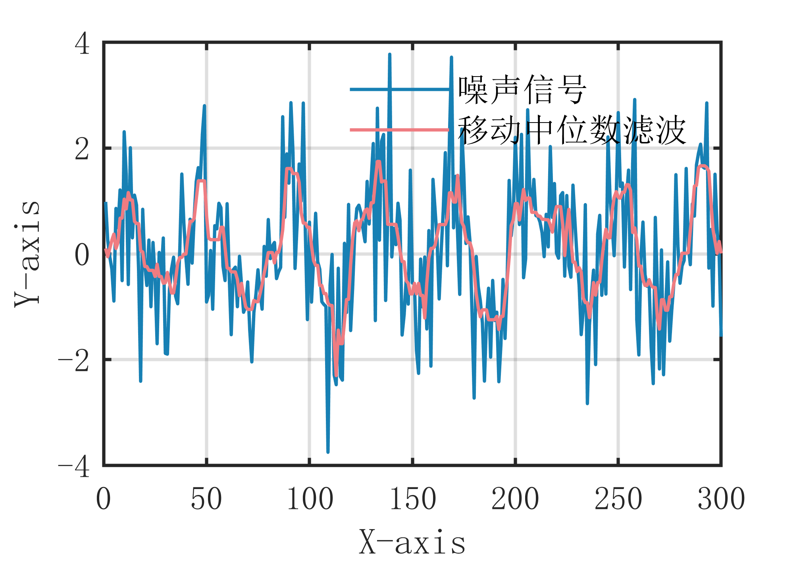

# MATLAB | Digital Signal Processing | Moving Median Filtering Algorithm | Includes data and plotting code | Directly Useable

1. Basic Definition
The moving median filter algorithm is a type of filtering method based on the median, which involves sliding a window over the signal and taking the median value within the window as the estimate for the current point to remove noise. The main idea behind this algorithm is to utilize the robustness of the median to effectively eliminate noise in the signal. Specifically, the steps of the moving median filter algorithm are as follows:
- Define a sliding window size, which is typically an odd number.
- Move the window forward one by one, taking the median value within the window as the estimate for the current point each time.
- Repeat step 2 until the entire signal has been processed. The advantage of the moving median filter algorithm is that it can effectively remove noise while preserving the overall trend of the signal; however, its effectiveness may decrease in some cases where the signal undergoes rapid changes. Additionally, the algorithm requires selecting an appropriate window size to achieve optimal filtering results.
2. Definition and Outline Effects
The outlining effects are as follows:
\n        \n  
Video tutorial operation:
\n        \n          \n          \n          \n          \n            To view this video please enable JavaScript, and consider upgrading to a\n            web browser that\n            supports HTML5 video\n

## Images

<!-- PAYMENT_BLOCK -->

## Get this dataset

- Payment link (Stripe): [Buy now](https://buy.stripe.com/3cs8yP7sY87d0vu9AB)
- Payment QR code: 

<!-- /PAYMENT_BLOCK -->
